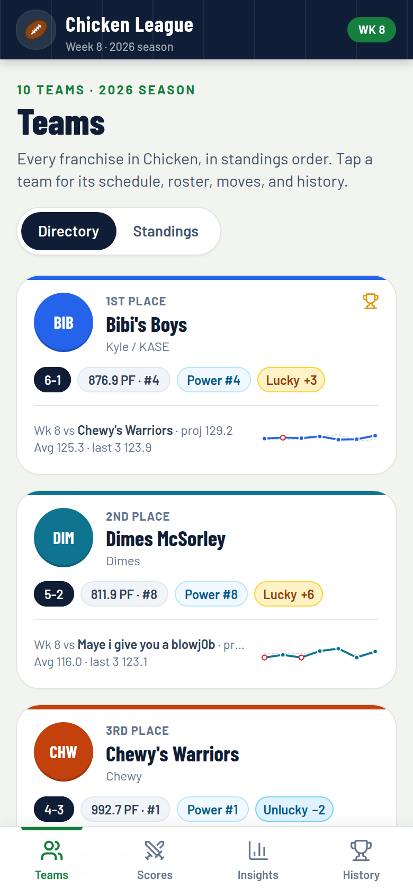
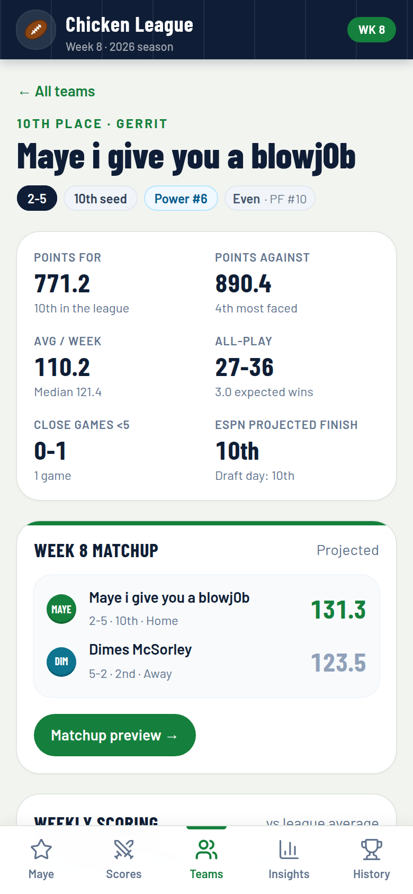
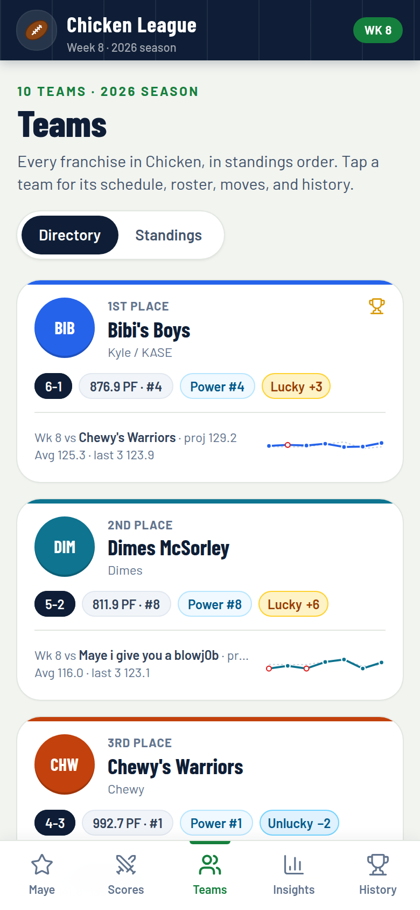
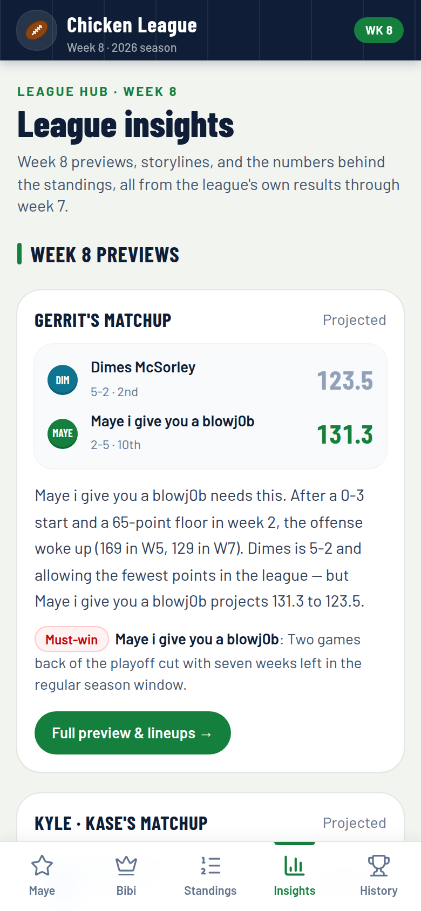
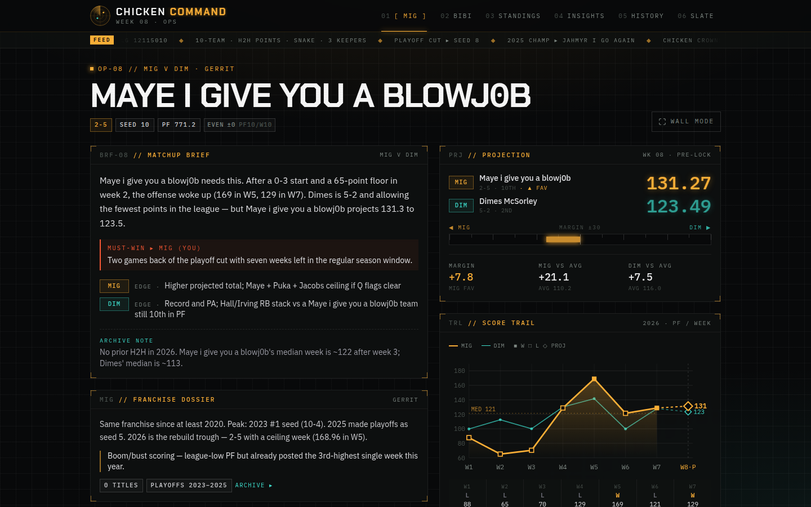

# Chicken League · Week 8

**Live:** [https://fantasy-board-demo.vercel.app](https://fantasy-board-demo.vercel.app). Share that link. It's public, needs no login, and works on iPhone.

**Chicken League** is the fantasy football hub for the private ESPN **Chicken** league (2026, week 8). Every one of the 10 teams gets a page, all 5 week 8 games get a preview, and the insights and history cover the whole league. Everything is prerendered from two committed JSON files, so it deploys to Vercel with **zero secrets**.

| Gerrit's matchup (`/`) | Team page | Teams | Insights |
| --- | --- | --- | --- |
|  |  |  |  |



## Pages

| Route | What it shows |
| --- | --- |
| `/` | Gerrit's **Maye i give you a blowj0b** (team 7) week 8 matchup. It uses the same layout as every `/matchups/[slug]` page. |
| `/matchups` | **Scores:** all 5 week 8 games with projections and a one-line preview, each linking to its matchup page, plus last week's final scores. |
| `/matchups/[slug]` | One page per week 8 game: `maye-dim`, `bib-chw`, `epz-kab`, `smf-snd`, `jah-ah`. Each page has: <ul><li>A projected scorecard and a data-generated preview: story, edges for each side, and what's at stake.</li><li>A tale of the tape (projection, points for and rank, power rank, all-play, averages, best and worst week, swing, points against, opponents' average, close games, titles).</li><li>The two teams' **all-time head-to-head series** (record, points, last meeting, each side's biggest win, streaks) with a roast line.</li><li>Both teams' weekly scoring, team cards with history, the starters' injury report, head-to-head lineups, and both benches and IR.</li></ul> |
| `/teams` | Directory of all 10 teams in standings order: record, PF and rank, power rank, luck, week 8 opponent, and recent form. A switch moves between it and `/standings`. |
| `/teams/[id]` | One page per team. It has: <ul><li>Record, seed, power rank, luck, PF/PA with ranks, all-play record, close-game record, and ESPN's projected finish.</li><li>The week 8 matchup and a weekly score chart against the **league average**.</li><li>A results table with each week's margin over or under the league average.</li><li>Boom or bust, luck and strength of schedule, the injury report, and recent moves.</li><li>The full roster (starters, bench, IR).</li><li>An **all-time head-to-head** section: easiest opponent ("Personal ATM" / "Favorite snack"), nemesis ("Kryptonite" / "Who's your daddy"), biggest win, most embarrassing loss, best and worst week, closest win and loss, streaks, playoff résumé, and a record table against every opponent. Each card has a roast line generated from its numbers.</li><li>A trophy case and a 2020–2025 season-by-season table.</li></ul> |
| `/standings` | Table with record, PF/PA, differential, PF rank, and a luck badge. Every team links to its page. |
| `/insights` | League-wide insights over all 10 teams and all 35 games: <ul><li>At-a-glance leaders and the week 8 slate.</li><li>**Power rankings** (by all-play), the **luck meter** (PF rank vs standings, plus wins vs all-play), points for, and **strength of schedule** (opponents' average).</li><li>A record book: **high scores**, **closest games**, **bad beats**, biggest blowouts, the **weekly top scorer**, and close-game records.</li><li>**Consistency** (boom or bust) and a **head-to-head grid**.</li></ul> |
| `/history` | Champions and runners-up for **2020–2025** (each under its name that season, with the current franchise name), the champion-seed pattern, the trophy case for all 10 franchises, and a finishes-by-season grid. Below that, the all-time **Hall of Fame / Hall of Shame** (highest and lowest score, biggest blowout, closest game, longest win and losing streaks, fewest points in a win, most points in a loss), two-week playoff records kept separate, the most-played and most lopsided rivalries, a **rivalry heatmap**, and every title-game score. |
| `/bibis` | Redirects to `/matchups/bib-chw` so old links keep working. |
| `/live` | The original polling board, which can read a public ESPN league (optional, not in the nav). |

On phones the nav is a five-tab bottom bar (Maye · Scores · Teams · Insights · History) that respects iPhone safe areas. Standings sits behind Teams. From `md` up the nav moves into the navy top bar and adds Standings. On `lg` screens matchup pages offer **TV mode**. Layouts are checked for horizontal overflow at 320, 390, and 1440 px on every route.

## Data

Two committed files are the source of truth:

- [`data/league-all-teams.json`](data/league-all-teams.json) is a Flaim/ESPN pull with all 10 teams, all 35 games from weeks 1–7, week 8 pairings with projections, rosters with injury status, recent transactions, and per-franchise history for 2020–2025.
- [`data/league-h2h-history.json`](data/league-h2h-history.json) is the all-time head-to-head pull: every game (`games`), each franchise's all-time record, series and single-game records (`franchises`), and league records (`leagueRecords`). Its `meta.scopeLabel` labels every head-to-head section, and `meta.minGamesForEasiestOrNemesis` sets the minimum games for an easiest opponent or nemesis.

Name handling:

- `lib/league.ts` maps the raw file into public types that **drop every `espnName` and `espnAbbrev`**, so pages and the API can only render `displayName` and the app abbreviation.
- Gerrit's team 7 shows its real ESPN name, `Maye i give you a blowj0b`, at his request. Other teams use their `displayName`, which applies the clean aliases (for example, team 11 is `Kabul FC` / `KAB`).
- Past-season names use each season's `displayName` (`seasonNames[].displayName` in the head-to-head file), never `espnName`.
- Owner names aren't in the data. The app shows the existing nickname (`ownerLabelFromApp`) only for the four teams that have one.
- Null fields are hidden rather than filled in.

How the code uses the data:

- `lib/league.ts`: teams, standings, games, week 8 matchups (with slugs), champions, and `publicLeague()` for the API.
- `lib/stats.ts`: derived stats. These include weekly league averages, all-play records, power rankings, luck (PF rank vs standings, and wins vs all-play), close-game records, high scores, closest games, bad beats, blowouts, weekly leaders, strength of schedule, consistency, the head-to-head map, the title board, and the champion-seed pattern.
- `lib/preview.ts`: builds each matchup preview from those numbers.
- `lib/h2h.ts`: loads the head-to-head file into name-safe types (series, franchise records, league records, title games) and formats weeks and streak ranges from each game's own scoring periods.
- `lib/roast.ts`: the PG-13 roast lines. Thresholds only pick the joke; every number in a line comes from the head-to-head file. Two-week playoff games stay out of the single-game margin records, as in the file, and a single week of a two-week game is captioned that way.
- History follows the ESPN team slot across seasons. Owners may have changed, and the pages say so. The file doesn't include the playoff team count, so standings draw no cut line.
- `GET /api/league` returns teams, games, week 8 matchups and champions, with display names only.
- `GET /api/matchup/:slug` returns one week 8 matchup with its preview. The old `golden-goose` and `bibis` ids still resolve.

To roll to a new week, replace both files and redeploy. Head-to-head labels and captions follow the new numbers automatically.

### Optional ESPN live path

`/live` and `GET /api/fantasy` keep the original ESPN adapter (`lib/espn.ts`). It defaults to built-in demo data. Set `MOCK_FANTASY=0` with `ESPN_LEAGUE_ID` and `ESPN_TEAM_ID` to read a league that is **viewable to public**. Private leagues need ESPN cookies, which this app never asks for. See `.env.example`. None of this affects the snapshot pages.

## Design system

- **Palette:** light field background (`field`), white cards, a navy app bar and scorecard (`navy`), turf green as the primary (`turf`), gold for leaders and champions (`gold`), and red for losses and injuries (`loss`). Each team has its own avatar color (`lib/league.ts`).
- **Type:** Barlow Condensed for scores, headings, and numbers. Barlow for text. Team names are never upper-cased, so the `0` in `blowj0b` stays distinct from an `O`.
- **Primitives:** `components/league/ui.tsx` holds `Card`, `PageHeader`, `SectionHeading`, `TeamAvatar`, `Pill`, `Stat`, `LuckBadge`, `ResultChip`, and `RangeBar`. `components/league/trail.tsx` holds `ScoreTrail` (against an opponent or the league average), `WeekStrip`, and `MiniTrail`. All charts share one y-scale.

## Run locally

```bash
npm i && npm run dev     # http://localhost:43123
npm run build && npm start
```

## Deploy to Vercel

**Production URL:** [https://fantasy-board-demo.vercel.app](https://fantasy-board-demo.vercel.app)

No environment variables are needed. The Vercel project `fantasy-board-demo` isn't connected to this GitHub repo, so pushes don't redeploy it. Redeploy by uploading a new build (`npx vercel --prod` from a linked checkout). Alternatively, grant the Vercel GitHub app access to the repo and link it so pushes to `main` redeploy automatically.

## Project structure

```
app/
  layout.tsx                 fonts, metadata, viewport (safe-area aware)
  (league)/layout.tsx        app chrome: navy top bar, bottom tab bar
  (league)/page.tsx          / — Gerrit's matchup (team 7)
  (league)/matchups/         /matchups (Scores) and /matchups/[slug]
  (league)/teams/            /teams and /teams/[id]
  (league)/standings/        /standings
  (league)/insights/         /insights
  (league)/history/          /history
  live/                      optional ESPN polling board
  api/league/                GET /api/league
  api/matchup/[slug]/        GET /api/matchup/:slug
  api/fantasy/               optional ESPN/mock feed for /live
components/league/           nav, UI primitives, score charts, matchup page, head-to-head, TV mode
data/league-all-teams.json   the league data (source of truth)
data/league-h2h-history.json all-time head-to-head data
lib/league.ts                data types, name-safe mapping, lookups
lib/stats.ts                 derived league stats
lib/preview.ts               data-generated matchup previews
lib/h2h.ts                   head-to-head loader and formatting
lib/roast.ts                 data-driven roast captions
lib/espn.ts                  optional public ESPN adapter
```
