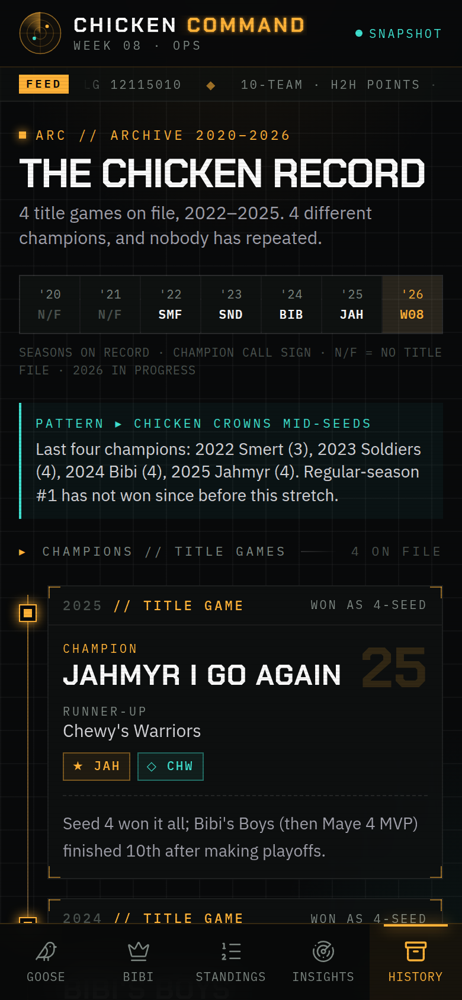
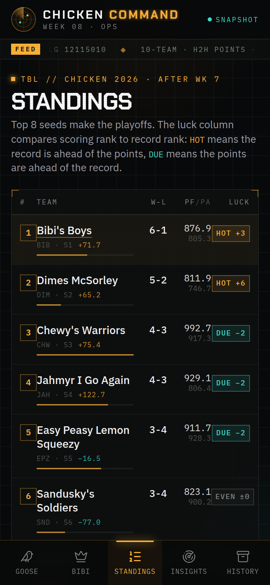

# Chicken Command · Week 08 Ops

**Live:** [https://fantasy-board-demo.vercel.app](https://fantasy-board-demo.vercel.app). Share that link. It's public, needs no login, and works on iPhone.

**Chicken Command** is the ops board for the private ESPN **Chicken** league (2026, week 8). It's a command-station console, not a scoreboard clone. Each matchup page leads with a brief. Score trails, a luck index, and a champions archive come from the league's own history. Everything is prerendered from committed JSON, so it deploys to Vercel with **zero secrets**.

| Goose op (`/`) | Insights | History | Standings |
| --- | --- | --- | --- |
|  |  |  |  |


## Pages

| Route | What it shows |
| --- | --- |
| `/` | Gerrit's **Golden Goose** vs Dimes McSorley. It opens with the **matchup brief** (story, must-win, edges, archive note). Below that are a projection readout with a margin gauge and a comparison to each team's season average, a **score trail** (weekly PF for weeks 1–7 plus a dashed week 8 projection, with the opponent overlaid), franchise dossiers, then head-to-head starters, bench and IR. |
| `/bibis` | Kyle's (KASE) **Bibi's Boys** vs Chewy's Warriors, same op layout. |
| `/standings` | League table with record, PF/PA, differential, **PF rank vs win rank**, and a **luck chip** (HOT, EVEN, or DUE). A labelled playoff cut sits after seed 8. |
| `/insights` | Week 8 dispatches from the matchup briefs, **league pulse** signals and alerts, the **luck index** bars, a ceiling board (top single weeks), a threat board, and franchise signatures with mini trails. |
| `/history` | Seasons on record (2020–2026), the **champions archive** for 2022–2025 as a phone timeline, an all-time **rings & finals** board, and **franchise arcs** for Goose, Bibi, Chewy and Dimes. Each arc has a season-by-season strip (champion, final, or file mention). |
| `/matchups` | "Slate": the featured ops with projections and a one-line brief. It's in the desktop nav only. |
| `/live` | The original polling board, which can read a public ESPN league (optional, not in the nav). |

On phones the nav is a five-tab bottom bar (Goose · Bibi · Standings · Insights · History) that respects iPhone safe areas. From `md` up it moves into the top bar. A FEED ticker under the header cycles league facts and pulse headlines. On `lg` screens the op boards offer **Wall mode**, which goes full screen for a TV. Layouts are checked for horizontal overflow at 320, 390, and 1440 px.

## Design system

- **Palette:** graphite (`ink` and `panel`), amber phosphor `phos` for the focus team and alerts, cyan `sig` for the opponent and signals, and `hot` only for must-win and the playoff cut. The tokens are in `app/globals.css`.
- **Type:** Chakra Petch for display, IBM Plex Mono for every label and readout, IBM Plex Sans for narrative text.
- **Chrome:** corner-bracket frames (`hud-corners`), a plotting-grid background (`bg-console`), scanlines, and a radar mark. Every team has a three-letter call sign (GGS, BIB, CHW, DIM…).
- **Primitives:** `components/league/hud.tsx` holds `Frame`, `PageHead`, `Tag`, `Readout`, `LuckChip`, `Radar`, and `Rule`. `components/league/trail.tsx` holds `ScoreTrail`, `WeekStrip`, and `MiniTrail`. Every trail shares one y-scale, so they compare directly.
- **Motion:** the radar sweep, ticker, and blink all stop under `prefers-reduced-motion`.

## Data

Two committed files, both with sanitized display names (keep them that way):

- [`data/league-snapshot.json`](data/league-snapshot.json) holds the current week's standings, the two featured matchups with starters and bench, and the power list.
- [`data/league-intel.json`](data/league-intel.json) holds champions, the all-time list, franchise arcs with `weekly2026` score trails, the luck index, matchup briefs, league pulse, and week 8 projections.

How the code uses them:

- `lib/league.ts` types the snapshot and maps each op board to its focus team (`BOARDS`).
- `lib/intel.ts` types the intel and derives the rest: call signs, trail stats (median, ceiling, floor), the title board (titles and finals from the champions list), champion seeds, and per-franchise archive hits. Intel's short names, like "Easy Peasy", resolve to snapshot team ids.
- `GET /api/league` returns the snapshot plus `intel`.
- `GET /api/matchup/golden-goose` and `GET /api/matchup/bibis` return one matchup with its `focus` and `opponent` sides. Unknown slugs return `404`.

To roll to a new week, replace both JSON files and redeploy.

### Optional ESPN live path

`/live` and `GET /api/fantasy` keep the original ESPN adapter (`lib/espn.ts`). It defaults to built-in demo data. Set `MOCK_FANTASY=0` with `ESPN_LEAGUE_ID` and `ESPN_TEAM_ID` to read a league that is **viewable to public**. Private leagues need ESPN cookies, which this app never asks for. See `.env.example`. None of this affects the snapshot pages.

## Run locally

```bash
npm i && npm run dev     # http://localhost:43123
npm run build && npm start
```

## Deploy to Vercel

**Production URL:** [https://fantasy-board-demo.vercel.app](https://fantasy-board-demo.vercel.app)

No environment variables are needed. The app is already deployed on Vercel under project `fantasy-board-demo` (Hobby team). Redeploy by uploading/pushing a new build, or after connecting the GitHub repo in Vercel (grant the Vercel GitHub app access to `fantasy-board-demo`, then import / link so pushes to `main` redeploy automatically).

From the CLI (linked account): `npx vercel --prod`.

## Project structure

```
app/
  layout.tsx                 fonts, metadata, viewport (safe-area aware)
  (league)/layout.tsx        console chrome: top bar, FEED ticker, bottom tab bar
  (league)/page.tsx          / — Golden Goose board
  (league)/bibis/            /bibis — Bibi's Boys board
  (league)/standings/        /standings
  (league)/insights/         /insights
  (league)/history/          /history
  (league)/matchups/         /matchups (Slate)
  live/                      optional ESPN polling board
  api/league/                GET /api/league
  api/matchup/[slug]/        GET /api/matchup/:slug
  api/fantasy/               optional ESPN/mock feed for /live
components/league/           nav, HUD primitives, score trails, op board, wall mode
data/league-snapshot.json    week snapshot (lineups, standings)
data/league-intel.json       league intel (history, trails, luck, briefs, pulse)
lib/league.ts                snapshot types + helpers
lib/intel.ts                 intel types + derived stats
lib/espn.ts                  optional public ESPN adapter
```
