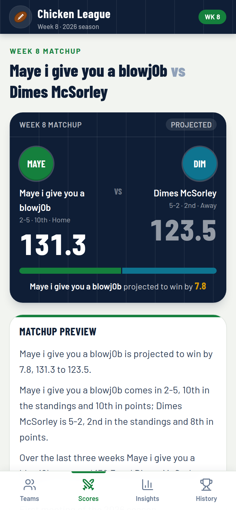

# Chicken League · Week 8

**Live:** [https://fantasy-board-demo.vercel.app](https://fantasy-board-demo.vercel.app). Share that link. It's public, needs no login, and works on iPhone.

**Chicken League** is the fantasy football hub for the private ESPN **Chicken** league (2026, week 8). Every one of the 10 teams gets a page, all 5 week 8 games get a preview, and the insights and history cover the whole league. Everything is prerendered from committed JSON, so it deploys to Vercel with **zero secrets**. The week number in the UI comes from `meta.currentWeek`. It is still week 8.

| Teams (`/teams`) | Team page | Matchup | Insights |
| --- | --- | --- | --- |
|  |  |  |  |


## Pages

| Route | What it shows |
| --- | --- |
| `/` | Redirects to `/matchups`. Opening the site lands on this week's scores and roast cards. |
| `/matchups` | **Scores**, the first page: **Week N Roasts** is one funny card per matchup, then all 5 current-week games. While the week is in progress, each side shows points so far and the projected final in brackets. Last week's finals sit under that. `/` and `/thursday` redirect here. |
| `/teams` | **Teams:** all 10 teams in standings order with record, PF and rank, power rank, luck, week 8 opponent, and recent form. A switch moves between it and `/standings`. Team 7's card is the only link to the playoff simulator. |
| `/matchups/[slug]` | One page per week 8 game: `god-dim`, `bib-chw`, `epz-kab`, `smf-snd`, `jah-ah`. `maye-dim` still opens the same game. Each page has: <ul><li>A projected scorecard and a data-generated preview: story, edges for each side, and what's at stake.</li><li>A tale of the tape (projection, points for and rank, power rank, all-play, averages, best and worst week, swing, points against, opponents' average, close games, titles).</li><li>The two teams' **all-time head-to-head series** (record, points, last meeting, each side's biggest win, streaks) with a roast line.</li><li>Both teams' weekly scoring, team cards with history, the starters' injury report, head-to-head lineups, and both benches and IR.</li></ul> |
| `/teams/[id]` | One page per team. The header and record pills sit above a sticky tab bar (**Overview · Roster · Trades · H2H · History**) so each section is one tap away instead of one long scroll. The open tab is kept in the URL hash (`/teams/7#trades`), so tabs can be linked and survive a reload. The tabs hold: <ul><li>Record, seed, power rank, luck, PF/PA with ranks, all-play record, close-game record, and ESPN's projected finish.</li><li>The week 8 matchup and a weekly score chart against the **league average**.</li><li>A results table with each week's margin over or under the league average.</li><li>Boom or bust, luck and strength of schedule, the injury report, and recent moves.</li><li>The full roster (starters, bench, IR).</li><li>An **all-time head-to-head** section: easiest opponent ("Personal ATM" / "Favorite snack"), nemesis ("Kryptonite" / "Who's your daddy"), biggest win, most embarrassing loss, best and worst week, closest win and loss, streaks, playoff résumé, and a record table against every opponent. Each card has a roast line generated from its numbers.</li><li>**Trades**: an all-time card (player trades, the 2020–2025 won-lost-even record on points, net points from trades in total and per season, and the all-time favorite trading partner), a 2026 card (verdict tally, offers sent and received as counts only, net rest-of-season value and net points), then the team's player trades in one dropdown per season, newest first, with the current season open and earlier seasons closed.</li><li>A trophy case and a 2020–2025 season-by-season table.</li></ul> |
| `/standings` | Table with record, PF/PA, differential, PF rank, and a luck badge. Every team links to its page. |
| `/insights` | League-wide insights over all 10 teams and all 35 games: <ul><li>At-a-glance leaders and the week 8 slate.</li><li>**Power rankings** (by all-play), the **luck meter** (PF rank vs standings, plus wins vs all-play), points for, and **strength of schedule** (opponents' average).</li><li>A record book: **high scores**, **closest games**, **bad beats**, biggest blowouts, the **weekly top scorer**, and close-game records.</li><li>**Consistency** (boom or bust) and a **head-to-head grid**.</li></ul> |
| `/history` | Champions and runners-up for **2020–2025** (each under its name that season, with the current franchise name), the champion-seed pattern, the trophy case for all 10 franchises, and a finishes-by-season grid. Below that, the all-time **Hall of Fame / Hall of Shame** (highest and lowest score, biggest blowout, closest game, longest win and losing streaks, fewest points in a win, most points in a loss), two-week playoff records kept separate, the most-played and most lopsided rivalries, a **rivalry heatmap**, and every title-game score. |
| `/trades` | **Trade desk**, 2020–2026: <ul><li>A banner with all-time player trades, players moved and a per-season bar chart (2026 offers and veto votes as counts).</li><li>All-time cards: most active trader, sharks vs suckers (net points from trades, with the 2020–2025 record), most-traded player (with a gap marker where he left a roster some other way) and the biggest heist on points.</li><li>Only player trades are listed, in one dropdown per season, newest first, with the current season open and earlier seasons closed; draft-pick-only swaps are counted in the banner but not listed.</li><li>2020–2025 cards show the date window and "after week N", each team's name that season, the points each side's players scored for their new team through the end of that regular season, and a points-only call: won, lost, even, lopsided ("won big" / "lost big") or too little data. One footnote explains they were rebuilt from weekly rosters, so offseason and player-for-pick deals are missing.</li><li>A 2026 card per player trade with the accepted date and time in ET and a "who won it so far" summary: each side's verdict from the file (paying off, even or backfiring), the confidence (from the weeks of data), the value edge and %, and the points gained.</li><li>Each side shows what it got, with each player's points for the new team, PPG before → after, current value, and bye, out, zero-stat, released and flipped labels. Below that: points for the new team (all points, started or benched), rest-of-season value received vs sent, the value edge, and the value change since the trade, or "value at trade date unavailable" with the PPG trend.</li><li>A roast line per trade that follows the verdicts.</li><li>2026 superlatives: most active trader, most offers sent, most negotiated pair, veto votes logged (not proof of who voted), player hot potato, the trade-and-cut, the best value so far, buyer's remorse (verdicts per team), and repeat customers.</li><li>How the verdicts work, with the FantasyCalc credit.</li></ul>Linked from History and the desktop nav. |
| `/playoffs` | Playoff simulator for team 7, plus the rest-of-season grade. It is not in the nav or the Find row. The only link is on team 7's card on `/teams`. `/simulator` redirects here. |
| `/bibis` | Redirects to `/matchups/bib-chw` so old links keep working. |
| `/thursday` | Redirects to `/matchups`. The Thursday card is gone. Points already scored, including Thursday, stay on the scoreboard. |
| `/share` | A share card of this week's real scores (points so far, projected final in brackets) with the system share sheet or a copied link. |

On phones the nav is a four-tab bottom bar (Scores · Teams · Insights · History) that respects iPhone safe areas. Standings sits behind Teams, and Trades behind History. Power rankings, awards, rivalries, and the share card are on the Teams page Find row. From `md` up the nav moves into the navy top bar (Scores · Teams · Standings · Insights · Trades · History), and the Find row hides anything that bar already has. The playoff simulator is not in either nav. On `lg` screens matchup pages offer **TV mode**. Layouts are checked for horizontal overflow at 320, 390, and 1440 px on every route.

## Data

The league files are the source of truth. Pages are server-rendered from them, so the big JSON stays off the client bundle.

- [`data/league-all-teams.json`](data/league-all-teams.json) is a Flaim/ESPN pull with all 10 teams, all 35 games from weeks 1–7, week 8 pairings with projections, rosters with injury status and bye week, recent transactions, and per-franchise history for 2020–2025.
- [`data/week-roasts.json`](data/week-roasts.json) is the current week's roast pack: one entry per matchup, with points so far, the headline, the roast, the ESPN projection, and a `LOCK:`, `UPSET ALERT:`, or `TOSS-UP:` tag. The scores page shows it only when its `week` matches `meta.currentWeek`.
- [`data/league-h2h-history.json`](data/league-h2h-history.json) is the all-time head-to-head pull: every game (`games`), each franchise's all-time record, series and single-game records (`franchises`), and league records (`leagueRecords`). Its `meta.scopeLabel` labels every head-to-head section, and `meta.minGamesForEasiestOrNemesis` sets the minimum games for an easiest opponent or nemesis.
- [`data/league-trades.json`](data/league-trades.json) is the 2026 trade pull: accepted trades with each side's players and picks, all points for the new team (`whoWonIt`) and the long-term grade (`longTermGrade`: per-side verdict, confidence, FantasyCalc redraft values received and sent, value change since the trade where available, and per-player PPG before and after with bye, out and zero-stat weeks), plus offers, declines and veto rows. `startedPointsForNewTeam` is reference only and never rendered. 2020–2025 entries have no ESPN transaction log (Flaim returns `ESPN_SEASON_NOT_SUPPORTED`), so those player-for-player trades were rebuilt from weekly roster snapshots: `acceptedAt` is null, `dateWindow` gives the days, `confidence` is `inferred`, and `whoWonIt.verdict` is a points-only call (`meta.pastSeasons` holds the method and the 10 / 75 point thresholds). Team summaries add `pastSeasonTradeRecord`, `netPointsFromTradesBySeason` and `partnersAllTime`; `leagueNotes.allTime` has trades per season and the most active traders. Raw ESPN team names (`espnName`) are stripped from the committed file.

Name handling:

- `lib/league.ts` maps the raw file into public types that drop `espnName` and `espnAbbrev` for every franchise except team 7. Other pages render `displayName` and the app abbreviation.
- Gerrit's team 7 shows ESPN's name, `Maye i give you a blowj0b`, and ESPN's abbreviation `GOD`. `MAYE` is used only when ESPN's abbreviation is itself MAYE. Other teams keep their clean `displayName` (for example, team 11 is `Kabul FC` / `KAB`).
- Past-season names use each season's `displayName` (`seasonNames[].displayName` in the head-to-head file), never `espnName`.
- Owner names aren't in the data. The app shows the existing nickname (`ownerLabelFromApp`) only for the four teams that have one.
- Null fields are hidden rather than filled in.
- Trades: offers, declines and veto rows are private negotiations, so only their counts are rendered. Pending and declined offers are never listed. Veto rows are labelled "veto votes logged" because ESPN doesn't say who cast them.

How the code uses the data:

- `lib/league.ts`: teams, standings, games, week 8 matchups (with slugs), champions, and `publicLeague()` for the API.
- `lib/stats.ts`: derived stats. These include weekly league averages, all-play records, power rankings, luck (PF rank vs standings, and wins vs all-play), close-game records, high scores, closest games, bad beats, blowouts, weekly leaders, strength of schedule, consistency, the head-to-head map, the title board, and the champion-seed pattern.
- `lib/preview.ts`: builds each matchup preview from those numbers.
- `lib/h2h.ts`: loads the head-to-head file into name-safe types (series, franchise records, league records, title games) and formats weeks and streak ranges from each game's own scoring periods.
- `lib/roast.ts`: the PG-13 roast lines. Thresholds only pick the joke; every number in a line comes from the head-to-head file. Two-week playoff games stay out of the single-game margin records, as in the file, and a single week of a two-week game is captioned that way.
- `lib/roasts.ts`: loads `data/week-roasts.json` for the scores page. Names, abbreviations, and records come from the team directory. `JIGA` and `KBL` in the prose are rewritten. A file whose `week` does not match `meta.currentWeek` is not shown.
- `lib/trades.ts`: loads the trade file into name-safe types (no `espnName`, no offer contents), keeps 2026 (long-term value) and 2020–2025 (points only) trades apart where grading differs, computes the all-time superlatives, reads each side's verdict, confidence and value figures straight from the file (value wins over points; no letter grades), and computes the superlatives and per-team trade summaries (net value is the sum of each graded side's value edge; net points comes from the file). Draft picks are labelled with team names.
- History follows the ESPN team slot across seasons. Owners may have changed, and the pages say so. The file doesn't include the playoff team count, so standings draw no cut line.
- `GET /api/league` returns teams, games, week 8 matchups, the current week's roasts, and champions, with display names only.
- `GET /api/matchup/:slug` returns one week 8 matchup with its preview. The old `maye-dim`, `golden-goose`, and `bibis` ids still resolve.

## Weekly refresh

The app does not call ESPN at runtime. A refresh is a JSON edit and a PR. Do not push straight to `main` (that deploys production).

1. Set `meta.currentWeek` in `data/league-all-teams.json` to the league week (the 2026 season is still on week 8; do not bump it just because the NFL week number moved).
2. Finished weeks live in `schedule.weeks1to7` (or `schedule.completed`). The current week lives in `schedule.week{N}`, which today is `schedule.week8`. Each game can carry:
   - `homeProjected` / `awayProjected` — projected final
   - `homeCurrentPoints` / `awayCurrentPoints` — fantasy points so far, including a real `0`
   - `status`: `"in-progress"` until the week is over, then a decided `winner` of `"HOME"` or `"AWAY"`
   - Mirror the same projections on each team's `week{N}` object (`projected`, `opponentProjected`)
3. Standings (`record`, `pointsFor`, `pointsAgainst`, `rank`) stay through the last completed week until you update them. Do not invent a result from the in-progress score. `currentProjectedRank` can move with the live projections.
4. Trades: append a processed deal to `trades` in `data/league-trades.json` with `"status": "accepted"` and a `processedAt` timestamp. Only that status is rendered. Proposals, declines, vetoes, and `unprocessedAccepts` are counts only — do not put player names for an offer into `trades`. To add points to an existing deal, add them to that player's `pointsForNewTeam` and to the side's `pointsReceived` / `pointsGained`, and set `week8Take` if the sample is too small to regrade. Leave the FantasyCalc `verdict.call` alone unless you have a new value pull. `droppedByTeamId` names who cut a player inside the deal.
5. Roasts: replace `data/week-roasts.json` with the new week. Set `week` to `meta.currentWeek` and include all five matchups. The card's name and abbreviation come from the team directory, including team 7's ESPN name and `GOD`. Do not put another franchise's raw ESPN name in the prose.
6. Playoff model: `data/playoff-model.json` week 8 projections feed the simulator. Weeks 9–14 stay as pulled unless you have a new projection file.

Head-to-head roasts, verdict captions, and the week label follow those fields. No env vars are required.

## Design system

- **Palette:** light field background (`field`), white cards, a navy app bar and scorecard (`navy`), turf green as the primary (`turf`), gold for leaders and champions (`gold`), and red for losses and injuries (`loss`). Each team has its own avatar color (`lib/league.ts`).
- **Type:** Barlow Condensed for scores, headings, and numbers. Barlow for text. Team names keep their written capitalization.
- **Primitives:** `components/league/ui.tsx` holds `Card`, `PageHeader`, `SectionHeading`, `TeamAvatar`, `Pill`, `Stat`, `LuckBadge`, `ResultChip`, and `RangeBar`. `components/league/trail.tsx` holds `ScoreTrail` (against an opponent or the league average), `WeekStrip`, and `MiniTrail`. All charts share one y-scale.

## Run locally

```bash
npm i && npm run dev     # http://localhost:43123
npm run build && npm start
```

## Deploy to Vercel

**Production URL:** [https://fantasy-board-demo.vercel.app](https://fantasy-board-demo.vercel.app)

No environment variables are needed. The Vercel project `fantasy-board-demo` is Git-linked: a push to `main` deploys production. Open a pull request for every change, including the weekly JSON refresh.

## Project structure

```
app/
  layout.tsx                 fonts, metadata, viewport (safe-area aware)
  (league)/layout.tsx        app chrome: navy top bar, bottom tab bar
  (league)/page.tsx          / redirects to /matchups
  (league)/matchups/         /matchups (Scores, roast cards) and /matchups/[slug]
  (league)/teams/            /teams directory; team 7's card links to /playoffs
  (league)/teams/[id]/       /teams/[id]
  (league)/standings/        /standings
  (league)/insights/         /insights
  (league)/history/          /history
  (league)/trades/           /trades
  (league)/playoffs/         /playoffs
  (league)/share/            /share
  api/league/                GET /api/league
  api/matchup/[slug]/        GET /api/matchup/:slug
components/league/           nav, UI primitives, score charts, roast cards, matchup page, team tabs, head-to-head, trades, share, TV mode
data/league-all-teams.json   teams, schedule, rosters (source of truth)
data/week-roasts.json        current-week roast cards
data/league-h2h-history.json all-time head-to-head data
data/league-trades.json      processed trades, 2020–2026 (offers are counts only)
lib/league.ts                data types, name-safe mapping, current-week scores
lib/roasts.ts                weekly roast loader for the scores page
lib/stats.ts                 derived league stats
lib/preview.ts               data-generated matchup previews
lib/h2h.ts                   head-to-head loader and formatting
lib/trades.ts                trade loader, verdicts, superlatives (accepted trades only)
lib/roast.ts                 data-driven roast captions
```
