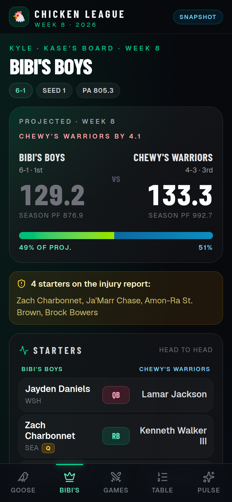

# Chicken League · Week 8 board

A phone-first, friend-shareable fantasy football app for the ESPN **Chicken** league (2026, week 8), built with Next.js (App Router). It reads a committed league snapshot, so it deploys to Vercel with **zero secrets**. The dark TV-board look is kept, and a full-screen TV mode is available on large screens.

| Golden Goose (`/`) | Bibi's Boys (`/bibis`) | Standings | Insights |
| --- | --- | --- | --- |
|  |  |  |  |


## Pages

| Route | What it shows |
| --- | --- |
| `/` | Gerrit's **Golden Goose** vs Dimes McSorley: projected scoreboard, injury-report callout, head-to-head starters, bench and IR. |
| `/bibis` | Kyle's (KASE) **Bibi's Boys** vs Chewy's Warriors, same layout. |
| `/standings` | Full league table: rank, record, PF/PA, point differential, playoff seed, and the playoff cut line after seed 8. |
| `/insights` | Storylines from the snapshot, power rankings, scoring leaders, and point-differential bars. |
| `/matchups` | Scoreboard cards for the featured week-8 matchups, linking to each board. |
| `/live` | The original polling board, which can read a public ESPN league (optional, not in the nav). |

On phones, navigation is a bottom tab bar that respects the iPhone safe areas. From the `md` breakpoint up it moves into the sticky top bar. Every page is statically prerendered, and layouts were checked for horizontal overflow at 320, 390, and 1440 px widths. On `lg` screens and up, the boards show a **TV mode** button that goes full screen and hides the navigation.

## Data

The single source of truth is [`data/league-snapshot.json`](data/league-snapshot.json): standings, the two featured matchups with starters and bench, and the insights. Team display names in it are already sanitized; keep them as they are. To update the board for a new week, replace that file and redeploy.

- `lib/league.ts` types the snapshot and maps each board to its focus team (`BOARDS`).
- `GET /api/league` returns the full snapshot.
- `GET /api/matchup/golden-goose` and `GET /api/matchup/bibis` return one matchup, with `focus` and `opponent` sides. Unknown slugs return `404`.

The pages and the route handlers import the same loader, so pages are prerendered at build time instead of fetching their own API.

### Optional ESPN live path

`/live` and `GET /api/fantasy` keep the original ESPN adapter (`lib/espn.ts`). It defaults to built-in demo data. Set `MOCK_FANTASY=0` with `ESPN_LEAGUE_ID` and `ESPN_TEAM_ID` to read a league that is **viewable to public**. Private leagues need ESPN cookies, which this app never asks for. See `.env.example`. None of this affects the snapshot pages.

## Run locally

```bash
npm i && npm run dev     # http://localhost:43123
npm run build && npm start
```

## Deploy to Vercel

No environment variables are needed.

1. In Vercel, choose **Add New → Project** and import `Gerritbandison/fantasy-board-demo` from GitHub. You can also use [this one-click link](https://vercel.com/new/clone?repository-url=https%3A%2F%2Fgithub.com%2FGerritbandison%2Ffantasy-board-demo).
2. Keep the detected **Next.js** preset and the default build settings, then click **Deploy**.
3. Share the production URL. Pushes to `main` redeploy automatically.

From the CLI: `npx vercel link`, then `npx vercel --prod`.

## Project structure

```
app/
  layout.tsx                 fonts, metadata, viewport (safe-area aware)
  (league)/layout.tsx        sticky top bar + bottom tab bar
  (league)/page.tsx          / — Golden Goose board
  (league)/bibis/            /bibis — Bibi's Boys board
  (league)/standings/        /standings
  (league)/insights/         /insights
  (league)/matchups/         /matchups
  live/                      optional ESPN polling board
  api/league/                GET /api/league
  api/matchup/[slug]/        GET /api/matchup/:slug
  api/fantasy/               optional ESPN/mock feed for /live
components/league/           nav, matchup board, chips, TV mode button
data/league-snapshot.json    week snapshot (primary data source)
lib/league.ts                snapshot types + helpers
lib/espn.ts                  optional public ESPN adapter
```
