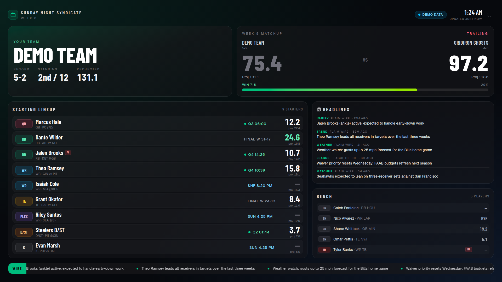
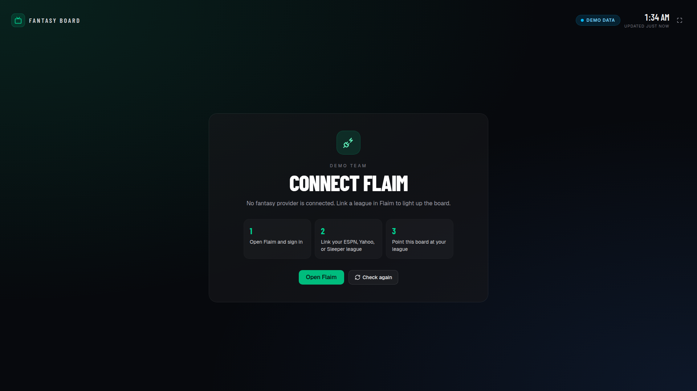
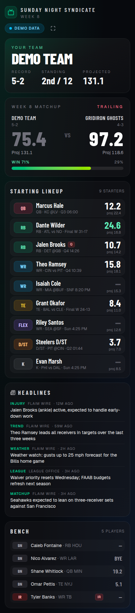

# Fantasy Board

A room-display fantasy football board built with Next.js (App Router), designed to run full-screen on a TV. It shows your team, record, standing, the live matchup score with win probability, your starting lineup and bench, and fantasy headlines.

It runs on **mock data by default**, so you don't need any secrets, accounts, or a backend.



| Disconnected ("Connect Flaim") | Mobile |
| --- | --- |
|  |  |

## Run locally

```bash
npm i && npm run dev
```

Open <http://localhost:43123>. The page polls `/api/fantasy` every 30 seconds. In mock mode, live game scores move a little over time so the board doesn't look frozen.

- `http://localhost:43123/?state=disconnected` previews the "Connect Flaim" empty state.
- `http://localhost:43123/api/fantasy` returns the JSON the board consumes.
- The button in the top-right corner switches the board to full screen. For a kiosk, run Chrome with `--kiosk http://<host>:43123`.

To customise the board, copy the env example and edit it:

```bash
cp .env.example .env.local
```

| Variable | Default | Purpose |
| --- | --- | --- |
| `FANTASY_TEAM_NAME` | `Demo Team` | The team name shown in the hero. |
| `MOCK_FANTASY` | `1` | `1` serves built-in mock data. `0` tries live ESPN. |
| `MOCK_FANTASY_STATE` | _(empty)_ | Set to `disconnected` to always show the empty state in mock mode. |
| `ESPN_LEAGUE_ID` | _(empty)_ | Live mode only. The ID of a public ESPN league. |
| `ESPN_TEAM_ID` | _(empty)_ | Live mode only. Your team's ID within that league. |
| `ESPN_SEASON` | current year | Live mode only. The season start year. |

## Deploy to Vercel

1. Push this repo to a Git host that Vercel can import (GitHub, GitLab, or Bitbucket).
2. In Vercel, choose **Add New → Project** and import the repo. The framework preset is detected as **Next.js**, so leave the build settings at their defaults.
3. Click **Deploy**. Mock mode doesn't need any environment variables.
4. Optional: under **Settings → Environment Variables**, set `FANTASY_TEAM_NAME`, or set `MOCK_FANTASY=0` together with the `ESPN_*` variables, then redeploy.

You can also deploy from the CLI with `npx vercel` and then `npx vercel --prod`.

## What's mocked and what's live

| Data | Mock mode (default) | Live mode (`MOCK_FANTASY=0`) |
| --- | --- | --- |
| League, team, record, standing | Fictional league in `lib/mock-fantasy.ts` | ESPN public league API |
| Matchup score and projections | Mock data, with scores that drift over time | ESPN `mMatchupScore` view |
| Win probability | Estimated from the projection gap | Not shown (ESPN doesn't expose it) |
| Roster and lineup slots | 14 fictional players | ESPN `mRoster` view |
| Headlines | Mock "Flaim Wire" items | ESPN public NFL news feed |
| Flaim | **Always mocked** | **Always mocked** |

**ESPN live mode** reads only public endpoints with no keys:

- League: `https://lm-api-reads.fantasy.espn.com/apis/v3/games/ffl/seasons/{season}/segments/0/leagues/{leagueId}?view=mTeam&view=mRoster&view=mMatchupScore&view=mSettings`
- News: `https://site.api.espn.com/apis/site/v2/sports/football/nfl/news`

The league endpoint only works when the league is set to **viewable to public** in the ESPN league settings. Private leagues return 401 because they need `espn_s2` and `SWID` browser cookies, and this app deliberately never reads or stores those. If ESPN fails for any reason, the API falls back to mock data and the board shows a notice explaining why. In live mode, per-player game clocks and opponents aren't available from these endpoints, so each player row shows whether that player is "Scoring" or "Projected".

**Flaim** has no public API that this demo can call, so it stays mocked. The disconnected state links to [flaim.app/leagues](https://flaim.app/leagues), where you connect leagues. No Flaim tokens are invented or required.

## API

`GET /api/fantasy` returns `200` with a `FantasyPayload` (see `lib/types.ts`). The response has one of two shapes:

- `status: "connected"`, with `league`, `team`, `matchup`, `roster`, `headlines`, `source` (`mock` or `espn`), and an optional `notice`.
- `status: "disconnected"`, with `teamName` and `reason`.

The query parameters `?state=disconnected` and `?mock=1` (which forces mock data) are passed through from the page URL.

## Project structure

```
app/
  page.tsx                 renders the board
  layout.tsx               fonts and dark theme
  api/fantasy/route.ts     route handler: mock, ESPN, or disconnected
components/
  FantasyBoard.tsx         client board: polling, loading, error, disconnected states
  ui/                      shadcn/ui primitives
lib/
  types.ts                 payload types shared by the API and UI
  mock-fantasy.ts          fictional Flaim/ESPN-shaped demo data
  espn.ts                  optional public ESPN adapter
  config.ts                env parsing
docs/                      README screenshots
```

## Privacy

All names in the mock data are fictional. The repo contains no real team names, emails, tokens, or LAN addresses, and the only env file in the tree is `.env.example`.
